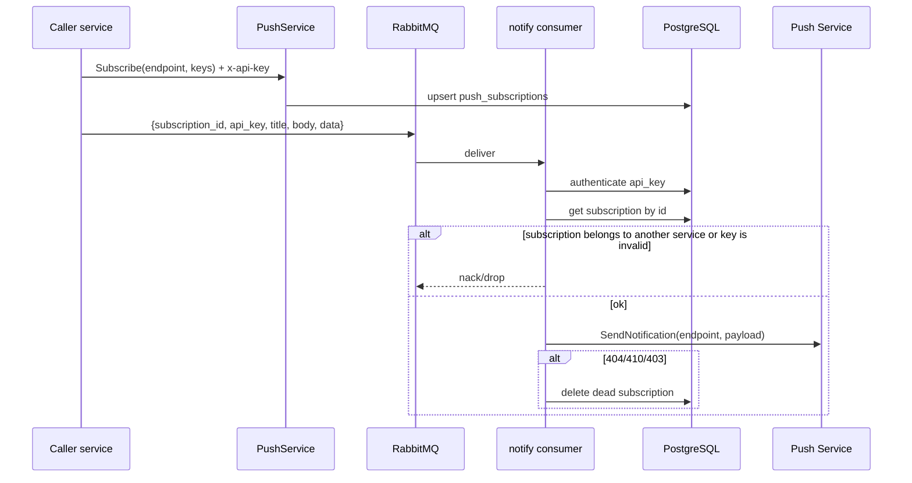

# notify specification

Database schema: [database.dbml](./database.dbml). Architecture overview: [architecture.md](./architecture.md).

Only other services talk to this backend. The browser talks to its own backend; that
backend proxies the subscription into notify over gRPC. The caller-service settings UI is a
separate application; this backend exposes gRPC `ClientRegistry`.

## Caller services and API keys

Registry of services that are allowed to call notify.

Each caller is registered as a `client` and receives an API key. The key is:

- placed in gRPC metadata `x-api-key` for Subscribe / Unsubscribe / GetVapidPublicKey;
- placed in the AMQP message when sending a push.

### Key material

- Prefix `ntf_` plus 32 random bytes, **base64url** without padding.
- The database stores the **SHA-256 of the full key** (`BYTEA UNIQUE`). Plaintext is not persisted.
- UI hint: `prefix` (8 characters) + `last4`.
- Plaintext is returned **once**: on Create and on RotateAPIKey.

### gRPC `ClientRegistry`

Metadata: `x-admin-key` must match `ADMIN_API_KEY` from the environment.
A caller-service key on these RPCs is `PERMISSION_DENIED`.

| RPC | Description |
|-----|-------------|
| `CreateClient` | Create a client and issue a key |
| `ListClients` | List (no secret) |
| `GetClient` | Client card (no secret) |
| `DeleteClient` | Soft-delete the client and its keys, delete its subscriptions |
| `RotateAPIKey` | New key; the old one stops working. Plaintext once |

Create:

```
{ "name": "dashboard-api-gateway", "description": "PAU dashboard" }
```

The response contains `key: "ntf_…"`. After that the key cannot be recovered.

### Configuration

| Variable | Description |
|----------|-------------|
| `ADMIN_API_KEY` | Bootstrap secret for `ClientRegistry`. Set in env, not stored in the database. |

The first service is registered with this key (or a script). After that the admin UI
uses the same `ADMIN_API_KEY`.

### Registry security

- Caller-service keys cannot manage the registry.
- Hash-at-rest, unique hash, soft-delete.
- Do not log plaintext keys or `ADMIN_API_KEY`.

## Web Push notifications

Browser push via the Web Push Protocol (VAPID). Subscriptions are stored **per
caller service**. Delivery is **asynchronous via RabbitMQ**.

### Data model

1. **`clients`** — caller-service registry.
2. **`api_keys`** — SHA-256 of the key, owned by a client.
3. **`push_subscriptions`** — browser subscriptions (`endpoint` unique within
   `client_id`; `p256dh` / `auth` keys).

Field and index details are in [database.dbml](./database.dbml).

### Runtime flow



In short:

1. The caller registers a user subscription over gRPC (service key in metadata).
2. To send a push, the caller publishes a queue message with `subscription_id`
   and its API key.
3. The consumer verifies the key, verifies the subscription owner, and sends the VAPID payload.
4. Without VAPID keys, send is skipped (debug log); the subscription API remains available.

### Payload

JSON delivered to the browser:

| Field | Type | Description |
|-------|------|-------------|
| `title` | string | Notification title |
| `body` | string | Body text |
| `data` | object | Arbitrary string fields from the caller service |

Broker message:

| Field | Type | Description |
|-------|------|-------------|
| `subscription_id` | string (UUID) | ID of the stored subscription |
| `api_key` | string | Plaintext caller-service key (`ntf_…`) |
| `title` | string | Title |
| `body` | string | Body text |
| `data` | object | Optional map string→string |

Do not log the key from the message.

### gRPC `PushService`

Metadata: `x-api-key: ntf_…`. Without a key — `UNAUTHENTICATED`.

| RPC | Description |
|-----|-------------|
| `GetVapidPublicKey` | Public VAPID key for `PushManager.subscribe` on the client |
| `Subscribe` | Create/update a subscription (`endpoint`, `p256dh`, `auth`, `user_agent`) |
| `Unsubscribe` | Delete a subscription by `endpoint` or `subscription_id` |

The subscription belongs to the service whose key arrived in metadata. Other services' subscriptions are inaccessible.

### Push configuration

| Variable | Description |
|----------|-------------|
| `VAPID_PUBLIC_KEY` | Public VAPID key |
| `VAPID_PRIVATE_KEY` | Private VAPID key |
| `VAPID_SUBJECT` | VAPID subject (email or `mailto:`) |
| `RABBITMQ_URL` | AMQP URL |
| `RABBITMQ_EXCHANGE` | Exchange (default `notify`) |
| `RABBITMQ_QUEUE` | Queue (default `notify.push.send`) |
| `RABBITMQ_ROUTING_KEY` | Routing key (default `push.send`) |

Key generation:

```bash
npx web-push generate-vapid-keys --json
```

or `task setup`.

### Push security

- Keep the private VAPID key in env/config only; never expose it to the client.
- The public key is available via `GetVapidPublicKey` (after the service API key).
- Subscription keys (`p256dh`, `auth`) are stored in the database; do not log them in full plaintext.
- Do not log the API key from the AMQP message.
- Provider responses `403` / `404` / `410` are treated as a dead subscription (the client must resubscribe).
- Sending to another service's subscription (service A key, service B `subscription_id`) is rejected.
