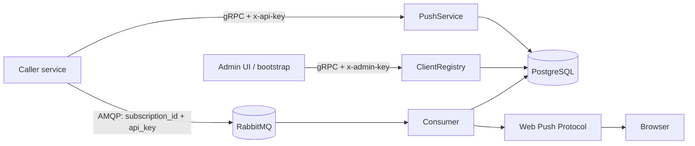

# notify architecture

This document describes the role of the notification service and its internal functional areas.
Contract and database schema: [README.md](./README.md), [database.dbml](./database.dbml).

## Purpose

`notify` is a dedicated Web Push backend. **Only other services** talk to it. Subscriptions are stored via gRPC; delivery goes through a message broker
(RabbitMQ). The caller-service settings UI lives in a separate application and talks
to this backend over gRPC.

## Components

| Component | Purpose |
|-----------|---------|
| **notify** *(this repository)* | gRPC API for subscriptions and the caller-service registry, RabbitMQ consumer, Web Push delivery |
| **PostgreSQL** | Caller services, API keys (hash-at-rest), browser push subscriptions |
| **RabbitMQ** | Push send queue (`subscription_id` + service API key + payload) |
| **Push Service** | Browser push provider over the Web Push Protocol (VAPID) |
| **Admin UI** *(separate service)* | Caller-service configuration |

## Data flows

1. An admin (or bootstrap) registers a caller service and receives the plaintext API key once.
2. The caller service stores and deletes user Web Push subscriptions over gRPC. Each RPC
   is authenticated with the service key (`x-api-key`).
3. The caller publishes a RabbitMQ message “send a push to `subscription_id`” and includes
   the same API key. The consumer verifies the key, checks that the subscription belongs to the service,
   encrypts the payload with VAPID, and delivers it to the browser.

## Transport

| Channel | Who | Why |
|---------|-----|-----|
| gRPC `PushService` | Caller services | Subscribe / Unsubscribe / VAPID public key |
| gRPC `ClientRegistry` | Admin UI / bootstrap | CRUD for caller services and key rotation |
| HTTP `/healthz`, `/version` | Orchestrator | Health and build info |
| RabbitMQ `notify.push.send` | Caller services | Asynchronous push delivery |

There is no direct REST API for subscriptions: users talk to their own service, and that service talks to notify.
